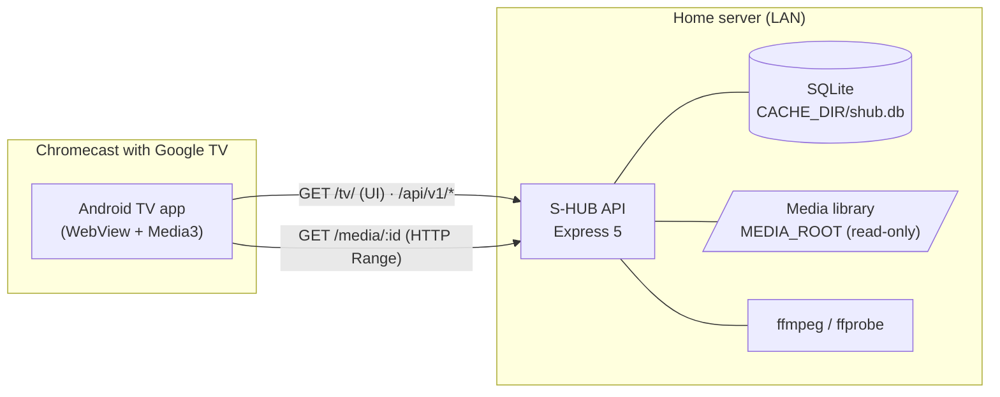

# S-HUB


S-HUB is a self-hosted home media hub. A Node/Express API streams your local movie and TV show library over the home network (LAN). A TV app shows it and plays it on a **Chromecast with Google TV**: a 10-foot web UI you drive with the remote, inside an Android TV app with a native Media3 player.

It plays your own files on the big screen without any cloud service, account or transcoding server. Media3 decodes MKV, HEVC, AC3/EAC3 and SRT subtitles natively. S-HUB also keeps per-profile history ("Continue watching", watched marks), PIN-protected profiles, subtitle language detection and per-video subtitle sync.

---

## 📋 Table of Contents

- [Architecture and Tech Stack](#-architecture-and-tech-stack)
- [Prerequisites](#%EF%B8%8F-prerequisites)
- [Installation and Setup](#-installation-and-setup)
- [Environment Variables](#-environment-variables)
- [Usage and Examples](#-usage-and-examples)
- [Running Tests](#-running-tests)
- [Deployment](#-deployment)
- [Contributing](#-contributing)
- [License](#-license)

---

## 🛠 Architecture and Tech Stack

An npm-workspaces monorepo. A single API process serves the REST API, the media streams and the built TV UI. The Android TV app is a thin native shell: it loads that UI in a WebView and plays the media with a native player.



| Path              | What it is                                                                                       |
| ----------------- | ------------------------------------------------------------------------------------------------ |
| `apps/api`        | REST API v1, media streaming with HTTP Range, thumbnails, SRT→WebVTT, profiles, history, devices |
| `apps/tv`         | 10-foot web UI for the TV (remote-control navigation), served by the API at `/tv/`               |
| `apps/android-tv` | Android TV app: WebView for the UI + native Media3/ExoPlayer for playback                        |
| `packages/shared` | API v1 contract as JSDoc types                                                                   |
| `workunits/`      | Work plan (WU-00 … WU-21)                                                                        |

- **Language / Runtime:** JavaScript (ESM) on Node.js 24 LTS · TypeScript in the TV UI · Kotlin 2.0 in the Android app
- **Frameworks:** Express 5, Preact 11 + Vite 8, AndroidX Media3 1.5 (ExoPlayer)
- **Database:** embedded SQLite (`node:sqlite`), a single file with no database server
- **Media:** ffmpeg / ffprobe (bundled via `ffmpeg-static` / `ffprobe-static`)
- **Quality:** `node:test`, ESLint 10 (flat config), Prettier
- **Infrastructure:** runs on a local PC today; Docker on a local Linux server is planned (WU-14)
- **CI/CD:** not set up yet

---

## ⚙️ Prerequisites

- Git
- Node.js `>= 22.13` (24 LTS recommended, see `.nvmrc`) and npm 10+
- A Chromecast with Google TV (or any Android TV device, Android 8.0+) on the same network, with **Developer options → Wireless debugging** enabled
- To build the Android app: JDK 17 and the Android SDK. `apps/android-tv/scripts/setup-wsl.sh` installs both on Linux/WSL without Android Studio.

ffmpeg and ffprobe are bundled. You don't need to install them.

---

## 🚀 Installation and Setup

1. **Clone the repository:**

   ```bash
   git clone https://github.com/JSanoja/s-media-hub.git
   cd s-media-hub
   ```

2. **Install dependencies (all workspaces):**

   ```bash
   npm install
   ```

3. **Configure the API:**

   ```bash
   cp apps/api/.env.example apps/api/.env
   ```

   Set at least `MEDIA_ROOT` (your library folder) and `PUBLIC_HOST` (this machine's LAN IP). See [Environment Variables](#-environment-variables).

4. **Build the TV UI and start the API:**

   ```bash
   npm run build   # builds apps/tv into apps/tv/dist
   npm start       # http://<PUBLIC_HOST>:<PORT>/tv/
   ```

5. **Build and install the Android TV app** (from Linux/WSL):
   ```bash
   bash apps/android-tv/scripts/setup-wsl.sh            # once: JDK 17 + Android SDK
   SERVER_URL=http://<PUBLIC_HOST>:<PORT> \
     bash apps/android-tv/scripts/deploy.sh <tv-ip>:<adb-port>
   ```
   The adb port appears on the TV under **Wireless debugging**. You can also change the server URL inside the app later.

### Library layout

Each movie, series or season folder can contain a poster named `cover.webp` (or `.jpg` / `.png`):

```
Movie Title (2010) [1080p]/       → movie
  cover.webp
  Movie.Title.2010.1080p.mp4
  Movie.Title.2010.1080p.srt      (or .es.srt / .en.srt)
Series Name/                      → series
  cover.webp
  Season 1/                       → season ("Temporada 1" and "S1" also work)
    Series.Name.S01E01.mkv
    Series.Name.S01E01.es.srt
```

---

## 🔐 Environment Variables

The API reads all its configuration from `apps/api/.env`; nothing network-related is hardcoded. To change the IP, the port or the protocol, edit `.env` and restart. The full list with comments is in [`apps/api/.env.example`](apps/api/.env.example).

| Variable                       | Default                              | Description                                                                          |
| ------------------------------ | ------------------------------------ | ------------------------------------------------------------------------------------ |
| `PROTOCOL`                     | `http`                               | `http` or `https` (`https` requires `TLS_CERT` and `TLS_KEY`)                        |
| `HOST`                         | `0.0.0.0`                            | Interface to listen on. Keep `0.0.0.0` so the TV can reach it                        |
| `PORT`                         | `3000`                               | API port                                                                             |
| `PUBLIC_HOST`                  | auto-detected LAN IPv4               | IP or hostname the TV uses to reach the API                                          |
| `PUBLIC_PORT`                  | `= PORT`                             | Public port (if a proxy or NAT sits in front)                                        |
| `PUBLIC_BASE_URL`              | `PROTOCOL://PUBLIC_HOST:PUBLIC_PORT` | Full override for every absolute URL the API returns                                 |
| `TLS_CERT` / `TLS_KEY`         | —                                    | Certificate and key paths (only with `https`)                                        |
| `MEDIA_ROOT`                   | `public/source`                      | Media library folder. It is only read, never written                                 |
| `CACHE_DIR`                    | `../../cache`                        | Thumbnails and the SQLite database. Must be outside `MEDIA_ROOT`                     |
| `TV_DIR`                       | `../tv/dist`                         | Built TV UI, served at `/tv/`                                                        |
| `PROFILE_PINS`                 | built-in defaults                    | Initial PINs, e.g. `obi:1234,papas:5678` (only used when profiles are first created) |
| `DEVICE_ACTIVE_SECONDS`        | `120`                                | Seconds without a heartbeat before a device stops counting as active                 |
| `CORS_ORIGINS`                 | `*`                                  | Allowed origins, comma-separated                                                     |
| `FFMPEG_PATH` / `FFPROBE_PATH` | bundled binaries                     | Use other ffmpeg/ffprobe builds                                                      |
| `LOG_FORMAT`                   | `dev`                                | HTTP log format (`dev`, `combined`, `off`)                                           |

Relative paths resolve against `apps/api`. The API validates everything at startup, fails with a clear message if something is wrong, and logs the effective public URL.

---

## 💡 Usage and Examples

**Scripts** (run from the repository root):

```bash
npm run dev       # API with auto-reload (node --watch)
npm run dev:tv    # TV UI with Vite hot reload, proxied to the API
npm run build     # build the TV UI
npm start         # API in normal mode
npm test          # all tests
npm run lint      # ESLint
npm run format    # Prettier
```

**On the TV:** open S-HUB from the apps row, pick a profile and enter its PIN.

| Key    | Library     | Player                                              |
| ------ | ----------- | --------------------------------------------------- |
| Arrows | move around | ← / → seek 10 s · ↑ show controls · ↓ subtitle sync |
| OK     | open / play | play / pause                                        |
| Back   | go back     | exit                                                |

In the subtitle sync panel, ← / → shift the subtitles by 0.5 s and ↑ / ↓ by 0.1 s. The offset is saved for that video.

**API examples** (`curl`):

```bash
# Library root and a folder (ids are opaque base64url strings)
curl http://192.168.0.50:3000/api/v1/library
curl "http://192.168.0.50:3000/api/v1/library?path=<folderId>"

# A video, with absolute stream / thumbnail / subtitle URLs
curl http://192.168.0.50:3000/api/v1/items/<itemId>

# Stream with HTTP Range (what the player uses to seek)
curl -H "Range: bytes=0-1023" -o /dev/null -w "%{http_code}\n" \
  http://192.168.0.50:3000/media/<itemId>

# Devices currently in use, and what they are playing
curl "http://192.168.0.50:3000/api/v1/devices?active=1"
```

The full endpoint list is in [`apps/api/README.md`](apps/api/README.md).

---

## 🧪 Running Tests

```bash
npm test          # API tests (node:test) across all workspaces
npm run lint      # ESLint
npm run format:check
```

The API tests start the app on a random port against a temporary media folder and an isolated database. They don't need the real library. To check the Android app:

```bash
cd apps/android-tv && ./gradlew assembleDebug lintDebug
```

---

## 📦 Deployment

**Today:** the API runs on a PC on the home network, over plain HTTP with a fixed LAN IP and port.

1. Reserve fixed IPs on the router for the server and the TV.
2. Set `HOST=0.0.0.0` and `PUBLIC_HOST=<server IP>` in `apps/api/.env`.
3. Open the API port in the firewall, for the private network profile only.
4. `npm run build && npm start`, then install the app with `deploy.sh`.

On WSL2, use `networkingMode=mirrored` so the LAN can reach the API, and allow the port with a Hyper-V firewall rule.

**Linux server on the LAN (over SSH):** `apps/api/scripts/deploy-server.sh` builds the TV UI and copies only what the API needs to run. It installs production dependencies on the server and runs the API as a systemd user service.

```bash
bash apps/api/scripts/deploy-server.sh user@192.168.1.80 --setup --with-db   # first time
bash apps/api/scripts/deploy-server.sh user@192.168.1.80                     # later updates
```

- `--setup` installs Node 24 if it's missing, enables lingering and opens the port in `ufw`.
- `--with-db` copies the local `shub.db` (profiles, PINs, history) and backs up the server's copy first.
- `--with-thumbs` and `--sync-media` also copy the thumbnails and the library.
- The server's `.env` is created on the first run and never overwritten.
- Run `bash apps/api/scripts/deploy-server.sh --help` for every option.

**Planned:** a Docker image on a local Linux server, with the library and the cache mounted as volumes (WU-14). HTTPS (`PROTOCOL=https`) is only needed for casting from a phone (WU-13, optional).

---

## 🤝 Contributing

1. Create a branch from `main` (`feat/...`, `fix/...`).
2. Keep `npm test` and `npm run lint` passing, and run `npm run format`.
3. Write commit messages in English using [Conventional Commits](https://www.conventionalcommits.org/) (`feat:`, `fix:`, `chore:`…).
4. Don't hardcode network values: every IP, port or URL comes from the environment.
5. Any user-supplied path must go through `resolveInside()` (`apps/api/src/lib/safePath.js`) before it touches the disk or ffmpeg.
6. Open a pull request describing what changed and how you tested it.

---

## 📄 License

No license has been chosen yet, so all rights are reserved by the author. Add a `LICENSE` file before reusing or redistributing this code.
