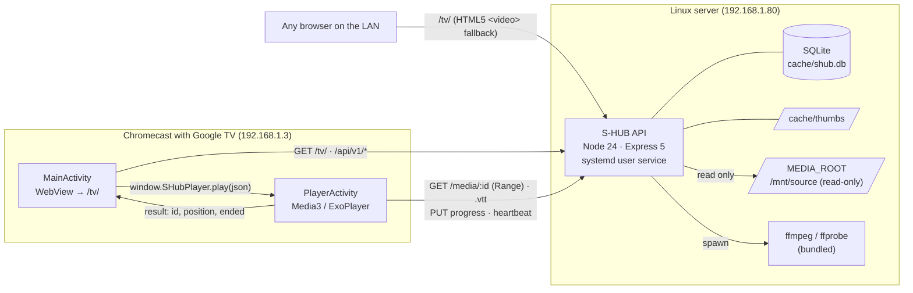
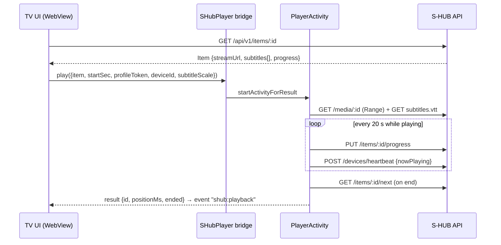

# S-HUB — Technical analysis and architecture

_Snapshot: 2026-11-13 · API 0.8.0 · TV UI 0.1.0 · Android app 0.2.2_

This document describes how S-HUB is built today and why, and lists the main risks and technical debt with a suggested order to address them. It is written for anyone who will maintain or extend the code. The work plan with each unit's details is in [`workunits/`](../workunits/README.md).

---

## 1. Summary

S-HUB is a self-hosted media hub for a single household. A Node.js API serves a local video library over the LAN. A TV app on a Chromecast with Google TV browses that library and plays it.

The design has three parts:

1. **A single API process** (`apps/api`) is the only server. It serves the REST API, the media streams with HTTP Range, the thumbnails and subtitles, and the built TV UI. There is no reverse proxy, no separate web server and no database server.
2. **The UI is a web app** (`apps/tv`, Preact). It is built for 10-foot use with the remote, and the API serves it at `/tv/`. Because the API serves it, updating the UI only means redeploying the API.
3. **A thin native shell** (`apps/android-tv`, Kotlin) loads that UI in a WebView. Playback goes to a native Media3/ExoPlayer activity through a JavaScript bridge. That is how the TV plays MKV, HEVC, AC3/EAC3 and SRT without transcoding.

| Metric                     | Value                                                                |
| -------------------------- | -------------------------------------------------------------------- |
| API source                 | ~2,050 lines of JavaScript (ESM) in 24 modules                       |
| API tests                  | 90 tests, ~1,300 lines (`node:test`)                                 |
| TV UI                      | ~1,670 lines of TS/TSX + 540 lines of CSS                            |
| Android app                | ~620 lines of Kotlin in 4 classes                                    |
| API runtime dependencies   | 5 (`express`, `helmet`, `morgan`, `ffmpeg-static`, `ffprobe-static`) |
| TV UI runtime dependencies | 1 (`preact`)                                                         |
| Android dependencies       | AndroidX core/appcompat/activity + Media3 1.5.1                      |
| Persistence                | One SQLite file (`node:sqlite`), 4 schema migrations                 |

The codebase is small, has few dependencies and is easy to follow end to end. Its main limits come from deliberate trade-offs for a home LAN: plain HTTP, trust in the local network, and no library index yet. Section 8 covers them.

---

## 2. System context



**Network model.** Everything uses plain HTTP to a fixed LAN IP and port. Every value comes from the environment (`PROTOCOL`, `HOST`, `PORT`, `PUBLIC_HOST`, `PUBLIC_BASE_URL`), so moving to another machine or to HTTPS only means editing `.env` and restarting.

---

## 3. Components

### 3.1 API (`apps/api`)

The API has a layered structure without a framework on top of Express. Every component is built by a factory that receives its dependencies, which keeps it testable.

```
server.js     HTTP/HTTPS server, startup banner, graceful shutdown (closes the DB, kills ffmpeg)
  └─ app.js   createApp(config, deps) — wires services and routers; deps can be injected in tests
      ├─ routes/      HTTP layer: validation, status codes, JSON shape
      │   ├─ v1.js        library, items, next, continue-watching, progress, watched
      │   ├─ profiles.js  profiles, PIN sessions, PIN change
      │   ├─ devices.js   heartbeat, list, forget
      │   └─ media.js     stream (Range), thumbnail, subtitles (.vtt), folder covers
      ├─ services/    domain logic
      │   ├─ library.js   walks MEDIA_ROOT, classifies folders, builds Item/Folder DTOs
      │   ├─ db.js        opens SQLite, WAL, migrations driven by PRAGMA user_version
      │   ├─ profiles.js  scrypt PIN hashes, session tokens (stored hashed), attempt lockout
      │   ├─ history.js   per-profile watch state, "Continue watching", watched marks
      │   ├─ devices.js   heartbeat upsert, active window
      │   ├─ subtitles.js subtitle language detection, cached in SQLite
      │   ├─ thumbs.js    on-demand thumbnails in CACHE_DIR, de-duplicated in flight
      │   └─ ffmpeg.js    spawn wrapper (array args, no shell, 60 s timeout)
      └─ lib/         pure helpers: ids, naming, safePath, subtitles, langDetect, cors,
                      rateLimit, errors, auth
```

**Key design decisions:**

- **Configuration** (`config.js`). All configuration is read and validated once at startup and returned as a plain object. Invalid values stop the process with a clear message, and the effective public URL is logged. The config also catches mistakes, such as `CACHE_DIR` inside `MEDIA_ROOT` or a loopback `HOST`.
- **Opaque IDs.** An item or folder ID is the base64url of its path relative to `MEDIA_ROOT`. IDs are stateless (no lookup table) and stable as long as files don't move. Every decoded ID goes through `resolveInside()`, which rejects `..`, absolute paths, symlink escapes and the wrong file type or extension.
- **Absolute URLs.** Every URL in a response is built from `config.publicBaseUrl`, never from the `Host` header. The native player and Cast receivers need absolute URLs, and building them from config avoids host-header injection.
- **Filesystem as the catalog.** The library is the folder tree. A folder is classified as `library`, `folder`, `movie`, `series` or `season` from its name and one level of content. Titles, years and SxxEyy numbers come from file names (`lib/naming.js`), with natural sort order. There is no metadata scraper.
- **Errors.** `HttpError` plus a final error handler always return `{ error: { code, message } }`, with stable codes such as `INVALID_PATH`, `NOT_FOUND`, `UNSUPPORTED_TYPE`, `PIN_LOCKED` and `PROFILE_REQUIRED`.
- **Media.** Streams use Express `res.sendFile` (HTTP Range, `206`, `Accept-Ranges`) with CORS that exposes `Content-Range` and `Content-Length`. SRT is converted to WebVTT on the fly; files that aren't valid UTF-8 are decoded as Windows-1252.

### 3.2 TV UI (`apps/tv`)

A single-page app built with Vite 8, Preact 11 and TypeScript. It has no router or state library.

| Module                       | Responsibility                                                                                                             |
| ---------------------------- | -------------------------------------------------------------------------------------------------------------------------- |
| `lib/router.ts`              | Hash routes `#/folder/:id`, `#/item/:id`, `#/play/:id`, `#/profile`. The API needs no SPA fallback.                        |
| `lib/focus.ts`               | Custom spatial navigation for the D-pad: it picks the nearest focusable element in the arrow's direction.                  |
| `lib/api.ts`                 | `fetch` wrapper with relative URLs (same origin) and the `X-Profile-Token` header.                                         |
| `lib/session.ts`, `prefs.ts` | Profile session and preferences in `localStorage` (`shub.*` keys, migrated from `jsflix.*`).                               |
| `lib/native.ts`              | Feature-detects `window.SHubPlayer`. With the bridge, playback goes native; without it, an HTML5 `<video>` player is used. |
| `lib/devices.ts`             | Device heartbeat every 60 s, on visibility changes and on profile changes.                                                 |
| `screens/*`                  | Profiles (picker and PIN keypad), Home ("Continue watching" and library), Folder, Detail, Player.                          |

Because the UI uses relative URLs and asks `/api/v1/config` for the public URL at startup, the same build works against any server.

### 3.3 Android TV app (`apps/android-tv`)

| Class             | Role                                                                                                                                                                                                                                                         |
| ----------------- | ------------------------------------------------------------------------------------------------------------------------------------------------------------------------------------------------------------------------------------------------------------ |
| `MainActivity`    | Fullscreen WebView loading `<server>/tv/`. It exposes the `SHubPlayer` bridge (`play`, `openSettings`, `serverUrl`, `version`, `deviceInfo`), handles connection errors and the server URL setting, and pauses WebView timers in the background.             |
| `PlayerActivity`  | Media3 player with external VTT subtitles, Spanish preferred. ←/→ seek 10 s. It saves progress at most every 20 s (always on pause, end, exit and background), sends a device heartbeat, and plays the next episode automatically through `/items/:id/next`. |
| `DeviceHeartbeat` | Device info and the heartbeat `POST`.                                                                                                                                                                                                                        |
| `ServerPrefs`     | Server URL in SharedPreferences. The build-time default comes from `-Pshub.serverUrl`.                                                                                                                                                                       |

The app is signed with the debug key and installed over wireless ADB (`scripts/deploy.sh`). It isn't distributed through Play.

### 3.4 Shared contract (`packages/shared`)

The API v1 contract (`Folder`, `Item`, `Subtitle`, `Progress`, `Device`, …) is documented as JSDoc typedefs. The TV UI has its own TypeScript copy in `apps/tv/src/lib/types.ts`. Nothing checks at build time that the two copies match (see §8).

---

## 4. Key flows

### 4.1 Start-up and profile session

1. The WebView loads `/tv/` and the UI calls `GET /api/v1/config`.
2. Without a stored session, the UI shows the profile picker (`GET /api/v1/profiles`).
3. `POST /api/v1/profiles/:id/session { pin, deviceId }` checks the PIN against a scrypt hash with a constant-time comparison.
   - **Success:** the API returns a random 256-bit token and stores only its SHA-256 hash.
   - **Failure:** each failed attempt is counted per (profile, client key). After 5 failures the API returns `429 PIN_LOCKED` for 60 s.
4. Later requests send `X-Profile-Token`. Endpoints that need a profile, such as progress and "Continue watching", return 401 without it. Library endpoints accept the header as optional and add per-profile `progress` when it is present.

### 4.2 Playback (native)



The UI passes the whole `Item` to the native side, so the player makes no extra API call to start playing.

### 4.3 Watch history

`history.report()` stores the position and the duration (when known):

- At **≥ 90 %** the item is marked as watched, and the mark stays even if the user rewinds.
- Items past **30 s** and not finished show up in "Continue watching".

Writes are throttled on the client (one save every 20 s at most, plus forced saves on pause, end and exit), so the database gets about 3 writes per minute per player.

### 4.4 Thumbnails

`GET /media/:id/thumb.jpg` returns the cached file when it exists. Otherwise the API takes the frame from the middle of the video (ffprobe for the duration, then ffmpeg), writes it to `CACHE_DIR/thumbs/<relative path>.jpg` and returns it. Requests for the same file in flight share one ffmpeg process. The endpoint is rate-limited to 120 requests per minute per IP.

---

## 5. Data model

One SQLite database, `CACHE_DIR/shub.db`, in WAL mode. The schema version is `PRAGMA user_version`; migrations are append-only and run at startup.

| Table              | Key                   | Content                                                                | Added |
| ------------------ | --------------------- | ---------------------------------------------------------------------- | ----- |
| `profiles`         | `id`                  | name, color, PIN hash and salt                                         | v1    |
| `profile_sessions` | `token_hash`          | profile, device, created and last used                                 | v1    |
| `pin_attempts`     | (profile, client key) | failures, locked until                                                 | v1    |
| `watch_state`      | (profile, item)       | position, duration, watched, device, updated at                        | v2    |
| `devices`          | `device_id`           | kind, name, model, app version, IP, profile, what's playing, last seen | v3    |
| `subtitle_lang`    | absolute path         | mtime, size, detected language, confidence (cache)                     | v4    |
| `subtitle_offsets` | (item, subtitle)      | **unused**: subtitle sync was withdrawn on 2026-11-12                  | v4    |

The library itself is **not** in the database: folders and items are read from disk on every request. History rows point at items by their path-based ID, so renaming or moving a file orphans its history. Orphaned rows are skipped silently in "Continue watching".

---

## 6. Deployment and operations

| Aspect        | Current state                                                                                                                                                                                                                                     |
| ------------- | ------------------------------------------------------------------------------------------------------------------------------------------------------------------------------------------------------------------------------------------------- |
| Server        | Linux on the LAN (192.168.1.80). Node 24 from NodeSource, systemd **user** service `s-hub` with lingering enabled.                                                                                                                                |
| Deployment    | `apps/api/scripts/deploy-server.sh` builds the UI, sends a tarball of about 84 KB over SSH, runs `npm ci --omit=dev` only when the lockfile changes, swaps `app/` (the previous version stays in `app.prev/`), restarts and checks `/api/health`. |
| Configuration | `~/s-hub/.env`, created once and never overwritten. `MEDIA_ROOT=/mnt/source`.                                                                                                                                                                     |
| State         | `~/s-hub/cache` (database and thumbnails). `--with-db` copies a consistent snapshot (`VACUUM INTO`) and backs up the server's copy first.                                                                                                         |
| Logs          | journald (`journalctl --user -u s-hub`) with morgan access logs. There are no metrics.                                                                                                                                                            |
| TV app        | `apps/android-tv/scripts/deploy.sh <tv-ip:port>`: Gradle build, then `adb install`.                                                                                                                                                               |
| Planned       | Docker image with the library and cache as volumes (WU-14); HTTPS only for casting from a phone (WU-13).                                                                                                                                          |

npm 12 blocks dependency install scripts by default, so the root `package.json` allows `ffmpeg-static@5.3.0` in `allowScripts`. Without it, the ffmpeg binary isn't downloaded and thumbnails fail. When `ffmpeg-static` is upgraded, that entry must be updated too.

---

## 7. Security model

The threat model is a **trusted home LAN**. Within that model:

| Control           | Implementation                                                                                                        |
| ----------------- | --------------------------------------------------------------------------------------------------------------------- |
| Path traversal    | `resolveInside()` on every path, extension allowlists per endpoint, no symlink escape. Covered by `security.test.js`. |
| Command injection | `spawn` with an argument array, no shell. Paths are validated before ffmpeg runs.                                     |
| Read-only library | The API never writes to `MEDIA_ROOT`, and the config rejects `CACHE_DIR` inside it.                                   |
| PINs              | scrypt with a per-profile salt, constant-time comparison, 5 attempts then a 60 s lock.                                |
| Sessions          | 256-bit random tokens. Only their SHA-256 hash is stored. Changing a PIN revokes all of that profile's sessions.      |
| Headers           | `helmet` (CSP disabled), no `x-powered-by`, CORS limited by `CORS_ORIGINS`.                                           |
| Abuse             | Thumbnail rate limit, ffmpeg timeout, deduplicated thumbnail jobs.                                                    |

**What is deliberately not protected:**

- Media, thumbnails, subtitles and the library listing need no profile. Anyone on the LAN can browse and stream.
- Traffic is plain HTTP, so PINs and tokens travel unencrypted on the LAN.
- The Android app allows cleartext to any host, because the server URL is user-configurable.

---

## 8. Risks and technical debt

Ordered by priority. **Impact** is what happens if it isn't addressed; **effort** is a rough size.

| #   | Finding                                                                                                                                                                                                                                                                                               | Impact                                                                                 | Effort       |
| --- | ----------------------------------------------------------------------------------------------------------------------------------------------------------------------------------------------------------------------------------------------------------------------------------------------------- | -------------------------------------------------------------------------------------- | ------------ |
| R1  | **The PIN lockout can be bypassed.** The lockout key is `device:<deviceId>` when the client sends a `deviceId`, and the client chooses that value. Sending a new random `deviceId` on each attempt resets the counter, so a 4-digit PIN (10,000 options) can be brute-forced from the LAN in minutes. | Profile PINs give little protection against anyone on the LAN                          | S            |
| R2  | **Sessions never expire.** `profile_sessions` has no TTL, and a token is valid until logout or a PIN change. A token copied from a device's `localStorage` works forever.                                                                                                                             | Long-lived credential                                                                  | S            |
| R3  | **There is no library index.** Every library or item request reads directories with `readdir` and `stat`, and `size` needs one `stat` per video. That is fine for tens of folders, but it degrades on large libraries or network mounts (`/mnt/source`).                                              | Slow browsing as the library grows                                                     | M (WU-06)    |
| R4  | **ffmpeg has no global concurrency limit.** Opening a folder with N videos for the first time starts up to N ffprobe+ffmpeg processes at once. Deduplication only helps for the _same_ file, and the rate limit (120/min) is per IP.                                                                  | CPU and I/O spikes on the server; the TV UI waits for thumbnails                       | S            |
| R5  | **Formats aren't checked.** Items have no `durationSec`, codec or `castCompatible` flag. The native player covers almost everything, but the browser fallback (`<video>`) can't play MKV, HEVC or AC3, and the UI can't warn about it.                                                                | Silent playback failures outside the TV app                                            | M (WU-06/08) |
| R6  | **The contract is duplicated.** `packages/shared` (JSDoc) and `apps/tv/src/lib/types.ts` (TS) are maintained by hand, and the Kotlin side parses JSON by key. Nothing checks they stay in sync; the recently removed `offsetMs` field had to be deleted in three places.                              | Drift between API and clients                                                          | S–M          |
| R7  | **The Android default server URL is out of date.** `gradle.properties` still bakes in `http://192.168.1.5:30001` (the old PC). A fresh install points to the wrong host until the URL is changed in the app, or the build passes `SERVER_URL`.                                                        | Confusing first run after reinstall                                                    | XS           |
| R8  | **There is no CI and the Android code has no tests.** Tests, lint and the APK build only run when someone remembers to run them. `PlayerActivity` (progress throttling, heartbeat, next episode) has no tests.                                                                                        | Regressions reach the TV, like the subtitle sync change that broke the player controls | M            |
| R9  | **The WebView bridge isn't tied to an origin.** `SHubPlayer` is exposed to any page the WebView loads. In practice that is only the configured server, but nothing enforces it (`shouldOverrideUrlLoading` and an origin check are missing).                                                          | Low on a LAN; matters if the UI ever loads external content                            | XS           |
| R10 | **There is no CSP.** `helmet` runs with `contentSecurityPolicy: false`.                                                                                                                                                                                                                               | Defense in depth against XSS in the UI                                                 | S            |
| R11 | **Mutating device routes have no auth.** `DELETE /api/v1/devices/:id` and the heartbeat accept any caller. It is consistent with the LAN trust model, but anyone can remove devices or spoof "now playing".                                                                                           | Low                                                                                    | XS           |
| R12 | **History is tied to paths.** IDs are paths, so renaming a folder (for example, adding the year) loses that item's history and subtitle language cache.                                                                                                                                               | Lost "Continue watching" and watched marks after reorganizing files                    | M            |
| R13 | **Leftovers.** The unused `subtitle_offsets` table, the `media:migrate-thumbs` script (only needed for the old layout), and the in-memory rate limiter that resets on restart.                                                                                                                        | Small maintenance cost                                                                 | XS           |

---

## 9. Strengths worth keeping

- **Low operating cost.** One process, one SQLite file, no external services; a backup is a copy of `cache/`.
- **Few dependencies.** Five runtime packages in the API and one in the UI. `npm audit` is clean, and upgrades are easy.
- **Native playback without transcoding.** Media3 on the TV handles the formats a browser can't, so the server stays light.
- **Testable API.** Factories with injectable dependencies, plus `createApp(config)`. The 90 tests run against temporary folders and an in-memory database, without the real library.
- **Strict configuration.** Validation at startup, with errors that explain the fix.
- **Documented decisions.** `workunits/` records the reason behind each decision and the acceptance criteria.

---

## 10. Recommendations

**Next (small, high value)**

1. **Fix R1.** Rate-limit PIN attempts per IP as well (lock on either key), or by IP alone. Add a test that rotates `deviceId`.
2. **Fix R2.** Add an idle expiry to sessions (for example 90 days since `last_used_at`) and clean up old rows at startup.
3. **Fix R4.** Add a small concurrency queue to `ffmpeg.js` (2 processes, for example) and let the UI load thumbnails lazily.
4. **Fix R7.** Point `shub.serverUrl` in `gradle.properties` to the server.

**Then**

5. **WU-06 index (R3, R5).** Store folders and items in SQLite with ffprobe metadata (duration, codecs, resolution), refreshed by a scan on startup and a file watcher or manual rescan. This also enables search and fixes R12 if history is keyed by a content fingerprint (size plus a hash of the first MB) instead of the path.
6. **CI (R8).** A GitHub Actions workflow with `npm ci`, lint, tests, the TV UI build and `./gradlew assembleDebug lintDebug`.
7. **One contract (R6).** Generate the TS types from the shared JSDoc with `tsc --declaration` on `packages/shared`, or move the contract to TS and import it from the UI.

**Later**

8. Docker image (WU-14), HTTPS only if Cast from a phone is needed (WU-13), a CSP for `/tv/` (R10), and a redesigned subtitle sync that doesn't take over the remote's keys.
